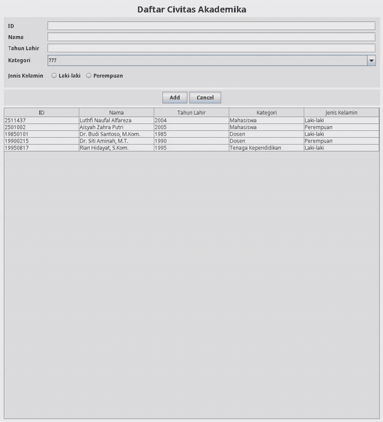

# Tugas Praktikum 4 - Desain dan Pemrograman Berorientasi Objek (DPBO) 2026

## Janji
Saya Luthfi Naufal Alfareza dengan NIM 2511437 mengerjakan Tugas Praktikum 4 dalam mata kuliah Desain dan Pemrograman Berorientasi Objek (DPBO) untuk keberkahan-Nya maka saya tidak akan melakukan kecurangan seperti yang telah dispesifikasikan. Aamiin.

---

## Struktur Direktori Proyek
```
TP4DPBO2526C1/
├── Dokumentasi
|   └── record_crud.gif
│    
├── PeopleData
│   ├── src
│   │   ├── PeopleMenu.form
│   │   ├── PeopleMenu.java
│   │   └── Person.java
│   └── PeopleData.iml
└── README.md
```

---

## Desain

### Person
- id : String
- nama : String
- tahunLahir : int
- kategori : String
- jenisKelamin : String

### PeopleMenu
- JPanel mainPanel;
- JTextField idField;
- JTextField namaField;
- JTextField tahunLahirField;
- JComboBox kategoriComboBox;
- JRadioButton rbLaki;
- JRadioButton rbPerempuan;
- ButtonGroup genderGroup;
- JButton addUpdateButton;
- JButton cancelButton;
- JButton deleteButton;
- JTable peopleTable;
- JLabel titleLabel;

---

## Alur Program

Setelah program dijalankan, jendela aplikasi menampilkan formulir input serta tabel daftar civitas akademika:

1. **Tambah Data (Create)**: Pengguna mengisi seluruh input form (id, nama, tahunLahir, pilihan kategori, dan radio button jenisKelamin), lalu menekan tombol **Add** untuk menyimpan data ke tabel.
2. **Pilih & Ubah Data (Update)**: Mengklik salah satu baris pada tabel akan memuat data tersebut kembali ke formulir. Tombol berubah menjadi **Update** dan tombol **Delete** akan muncul. Ubah data lalu tekan **Update** untuk memperbarui isi tabel.
3. **Hapus Data (Delete)**: Menekan tombol **Delete** akan memunculkan dialog konfirmasi terlebih dahulu. Data baru akan terhapus jika pengguna menekan **Yes**.
4. **Reset Form (Cancel)**: Menekan tombol **Cancel** akan mengosongkan kembali formulir, membersihkan seleksi tabel, mengembalikan tombol ke **Add**, dan menyembunyikan tombol **Delete**.

---

## Dokumentasi


